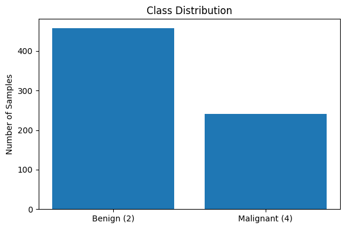
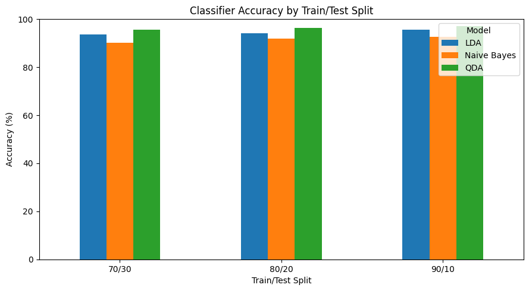
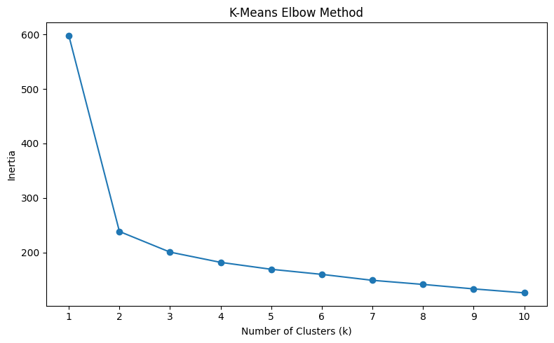
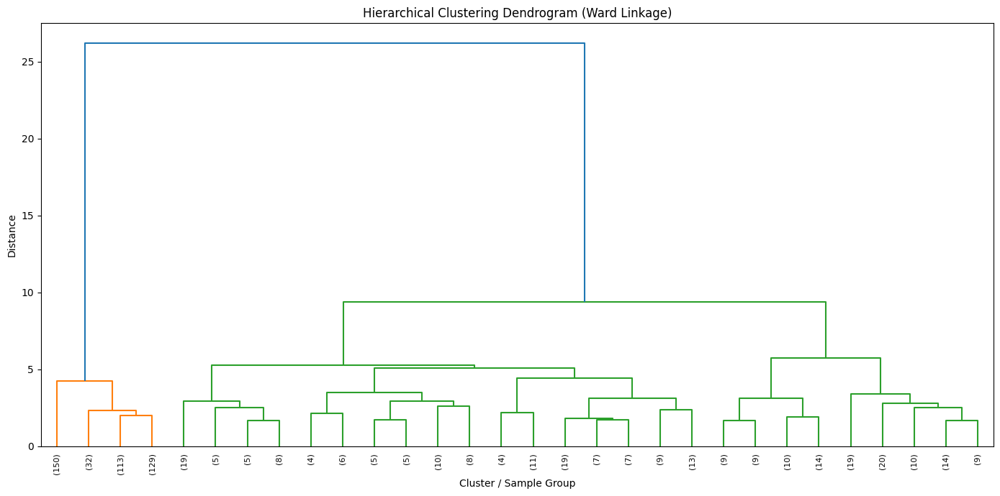

# Breast Cancer Classification using Pattern Recognition Techniques

University **Pattern Recognition** project reconstructed and cleaned for portfolio presentation.

The project applies classical pattern recognition and machine learning techniques to the **Wisconsin Breast Cancer dataset** in order to classify samples as **benign** or **malignant**.

## Project Context

This repository is a reconstructed and improved portfolio version of a university project originally developed for a Pattern Recognition course.

The original project scope and core methodology were preserved, while the implementation was improved for:

- correctness,
- reproducibility,
- readability,
- documentation,
- and GitHub presentation.

The goal was not to transform the coursework into a significantly more advanced machine learning project, but to present the original academic work in a cleaner and technically correct form.

## Methods

### Supervised Learning

- Linear Discriminant Analysis (LDA)
- Quadratic Discriminant Analysis (QDA)
- Multinomial Naive Bayes

### Unsupervised Learning

- K-Means Clustering
- Elbow Method
- Silhouette Analysis
- Hierarchical Clustering with Ward linkage

## Dataset

The project uses the **Wisconsin Breast Cancer dataset**.

The original dataset contains:

- 699 samples
- 9 predictive features
- 1 sample identifier
- 1 class label

The original class labels are:

- `2` → Benign
- `4` → Malignant

After removing 16 rows containing missing values, the cleaned dataset contains **683 samples**.

## Main Results

| Method | Best Result |
|---|---:|
| LDA | 95.65% accuracy |
| QDA | **97.10% accuracy** |
| Naive Bayes | 92.75% accuracy |
| K-Means | 96.05% mapped accuracy |
| Best Silhouette Score | 0.5968 |
| Best Silhouette k | 2 |

The strongest supervised result in the reproducible experiments was obtained with **Quadratic Discriminant Analysis (QDA)** using the 90/10 split.

## Example Results

### Class Distribution



### Supervised Model Comparison



### K-Means Elbow Method



### Hierarchical Clustering



## Repository Structure

```text
pattern-recognition-breast-cancer/
│
├── data/
│   ├── breast-cancer-wisconsin.data
│   └── breast-cancer-wisconsin.names
│
├── docs/
│   └── Pattern_Recognition_Breast_Cancer_Report.md
│
├── notebooks/
│   └── breast_cancer_pattern_recognition.ipynb
│
├── results/
│   └── figures/
│       ├── 01_class_distribution.png
│       ├── 02_feature_distributions_boxplot.png
│       ├── 03_classifier_accuracy_comparison.png
│       ├── 04_lda_confusion_matrix.png
│       ├── 05_qda_confusion_matrix.png
│       ├── 06_naive_bayes_confusion_matrix.png
│       ├── 07_kmeans_elbow_method.png
│       ├── 08_silhouette_score_analysis.png
│       ├── 09_kmeans_confusion_matrix.png
│       └── 10_hierarchical_clustering_dendrogram.png
│
├── .gitignore
├── README.md
└── requirements.txt
```

## Installation

Clone the repository and install the required Python packages:

```bash
python -m pip install -r requirements.txt
```

## Running the Project

Open:

```text
notebooks/breast_cancer_pattern_recognition.ipynb
```

with Jupyter Notebook, JupyterLab, or VS Code.

Then run all cells from top to bottom.

The notebook uses a fixed random state for reproducible train/test splits and clustering results.

## Implementation Improvements

The portfolio version improves the implementation through:

- correct dataset loading using `header=None`,
- preservation of all original rows before cleaning,
- correct handling of missing values,
- removal of the sample identifier from predictive features,
- explicit class encoding,
- 1D target representation,
- reproducible train/test splits,
- stratified splitting,
- training-only feature scaling for supervised learning,
- correct K-Means cluster-to-class mapping,
- corrected silhouette analysis,
-  clearer plots and documentation.

## Full Report

A detailed technical report is available here:

[Pattern Recognition Breast Cancer Report](docs/Pattern_Recognition_Breast_Cancer_Report.md)

## Technologies

- Python
- Jupyter Notebook
- NumPy
- pandas
- Matplotlib
- scikit-learn
- SciPy

## Limitations

This project is an educational Pattern Recognition exercise and not a clinical diagnostic system.

The implementation intentionally does not include advanced techniques such as:

- deep learning,
- extensive hyperparameter optimization,
- production ML pipelines,
- deployment,
- or advanced feature engineering.

These additions would substantially change the scope of the original university coursework.

## Author

**Vasileios Troupis**

University portfolio project — Pattern Recognition
