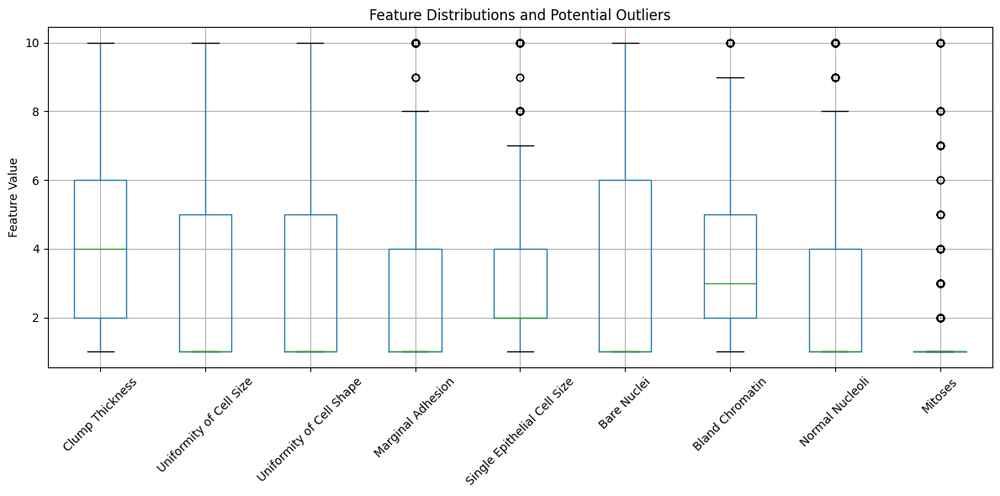
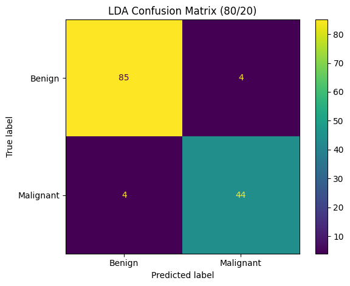
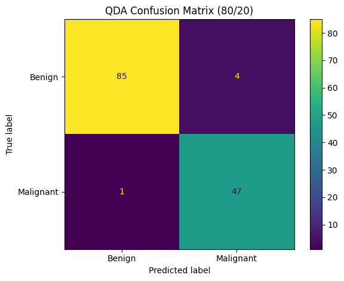
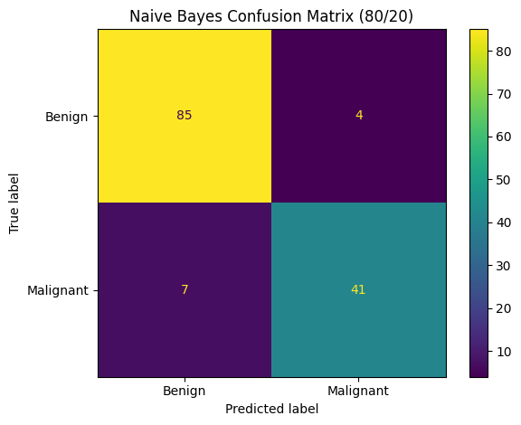
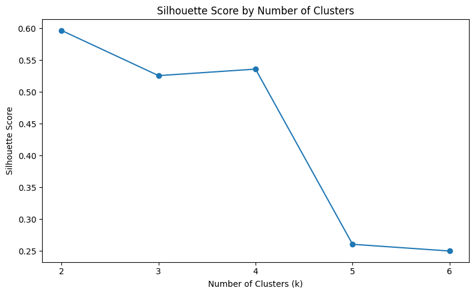
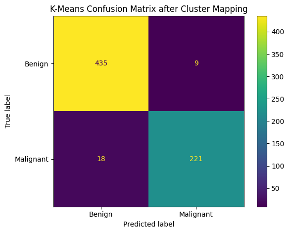

# Breast Cancer Classification using Pattern Recognition Techniques

## Project Overview

This project is a cleaned and reconstructed portfolio version of a university assignment originally developed for the **Pattern Recognition** course.

The goal is to classify breast cancer samples as **benign** or **malignant** using classical pattern recognition and machine learning techniques.

The reconstructed version preserves the scope and methodology of the original coursework while improving reproducibility, code clarity, documentation, and evaluation.

The main methods used are:

- Linear Discriminant Analysis (LDA)
- Quadratic Discriminant Analysis (QDA)
- Multinomial Naive Bayes
- K-Means Clustering
- Elbow Method
- Silhouette Analysis
- Hierarchical Clustering

---

## Dataset

The project uses the **Wisconsin Breast Cancer dataset**.

Each sample contains numerical measurements extracted from breast cell samples.

The original diagnostic labels are:

- `2` → Benign
- `4` → Malignant

The dataset initially contains:

- **699 samples**
- **9 predictive features**
- **1 sample identifier**
- **1 class label**

The predictive features are:

1. Clump Thickness
2. Uniformity of Cell Size
3. Uniformity of Cell Shape
4. Marginal Adhesion
5. Single Epithelial Cell Size
6. Bare Nuclei
7. Bland Chromatin
8. Normal Nucleoli
9. Mitoses

The sample identifier is not used as a predictive feature.

---

## Class Distribution

The dataset contains more benign than malignant samples.


This class imbalance is moderate rather than extreme, but stratified train/test splitting is used so that the class proportions remain approximately consistent across the training and testing sets.

---

## Data Cleaning

The `Bare Nuclei` feature contains missing values represented by `?`.

The dataset contains:

- **16 rows with missing values**

These rows are removed, following the same simple strategy used in the original coursework.

After removing missing values, the final dataset contains:

- **683 samples**

The `Sample code number` column is also removed because it is only an identifier and has no meaningful predictive value.

The class labels are then encoded as:

- `0` → Benign
- `1` → Malignant

---

## Exploratory Data Analysis

Descriptive statistics are calculated for all predictive features.

A boxplot is also used to inspect the feature distributions and identify possible statistical outliers.



Some variables contain values that appear as outliers according to the boxplot.

However, these values are valid observations from the dataset and are therefore not automatically removed.

This also avoids reproducing an error present in the surviving original notebook, where the outlier filtering condition accidentally retained outliers instead of removing them.

---

## Feature Scaling

The predictive variables are scaled using **Min-Max normalization**.

For supervised learning, scaling is fitted only on the training data and then applied to the corresponding test data.

This prevents information from the test set from influencing the training process.

---

# Supervised Learning

Three classical classification algorithms are evaluated:

- Linear Discriminant Analysis
- Quadratic Discriminant Analysis
- Multinomial Naive Bayes

Three train/test configurations are used:

- 70/30
- 80/20
- 90/10

A fixed random state is used for reproducibility, and stratification is applied to preserve class proportions.

---

## Linear Discriminant Analysis

Linear Discriminant Analysis assumes that the classes share a common covariance structure and attempts to find a linear decision boundary that separates the classes.

LDA is a classical Pattern Recognition technique and performs well on this dataset.

For the representative **80/20 split**, the confusion matrix is shown below.



---

## Quadratic Discriminant Analysis

Quadratic Discriminant Analysis allows each class to have its own covariance matrix.

This results in a quadratic rather than linear decision boundary and provides slightly better performance than LDA in the experiments performed in this project.

For the representative **80/20 split**, the confusion matrix is shown below.



---

## Multinomial Naive Bayes

Multinomial Naive Bayes is also evaluated as a simpler probabilistic classifier.

Its performance is lower than both LDA and QDA, but it still achieves a strong classification accuracy.

For the representative **80/20 split**, the confusion matrix is shown below.



---

## Supervised Model Comparison

The three classifiers are evaluated across all three train/test ratios.

| Model | 70/30 | 80/20 | 90/10 |
|---|---:|---:|---:|
| LDA | 93.66% | 94.16% | 95.65% |
| QDA | 95.61% | 96.35% | **97.10%** |
| Naive Bayes | 90.24% | 91.97% | 92.75% |


The best supervised result in this reproducible execution is:

**QDA — 90/10 split — 97.10% accuracy**

However, this result should not be interpreted as proof that using a smaller test set always improves model performance.

The different train/test configurations contain different samples, and a single split is not sufficient to establish such a general conclusion.

---

## Detailed QDA Performance

For the representative **80/20 split**, QDA achieves approximately:

- **Accuracy:** 96.35%
- **Benign recall:** 95.51%
- **Malignant recall:** 97.92%

The strong malignant recall is particularly important because it indicates that the classifier correctly identifies most malignant samples in this test split.

---

# Unsupervised Learning

The project also investigates whether the data naturally form groups that resemble the two diagnostic classes.

The main unsupervised techniques are:

- K-Means Clustering
- Elbow Method
- Silhouette Analysis
- Hierarchical Clustering

---

## K-Means Clustering

K-Means is applied to the normalized feature matrix.

Because the dataset represents two known diagnostic classes, special attention is given to whether the clustering structure also supports two groups.

---

## Elbow Method

The Elbow Method evaluates the within-cluster sum of squares for different values of `k`.


The largest improvement occurs when moving from one cluster to two clusters, after which the reduction in inertia becomes more gradual.

This supports the use of `k = 2`.

---

## Silhouette Analysis

Silhouette scores are calculated for multiple cluster counts.



The highest silhouette score is obtained with:

- **k = 2**
- **Silhouette Score ≈ 0.5968**

This provides additional evidence that the dataset naturally forms two relatively well-separated groups.

---

## K-Means with Two Clusters

K-Means is then executed using:

```python
n_clusters = 2
```

Because K-Means cluster IDs are arbitrary, the generated cluster labels are first mapped to the majority diagnostic class within each cluster.

The resulting mapping is:

- Cluster 0 → Malignant
- Cluster 1 → Benign

After this mapping, the clustering result achieves approximately:

- **96.05% mapped accuracy**



This result suggests that the natural structure of the feature space corresponds closely to the benign and malignant diagnostic categories.

---

## Hierarchical Clustering

Hierarchical clustering is performed using **Ward linkage**.

The dendrogram visualizes how individual samples and smaller clusters are progressively merged into larger groups.


The dendrogram also suggests the presence of a strong two-group structure in the dataset.

---

# Improvements over the Surviving Original Notebook

The original university notebook was preserved as a reference, but it contained several technical and methodological issues.

The reconstructed portfolio version improves the implementation while preserving the original academic scope.

The main improvements are:

- Correct dataset loading using `header=None`
- Preservation of all 699 original rows before cleaning
- Correct removal of missing-value rows
- Removal of the sample identifier from predictive features
- Explicit class encoding
- Correct 1D target representation
- Reproducible train/test splitting
- Stratified train/test splitting
- Feature scaling fitted only on training data
- Correct K-Means cluster-to-class mapping
- Correct silhouette evaluation
- Removal of unused code and imports
- Clearer plots and documentation
- Improved notebook organization

The reconstruction intentionally avoids introducing advanced techniques that would substantially change the character of the original coursework.

---

# Limitations

This project remains an educational Pattern Recognition exercise rather than a production medical machine learning system.

Important limitations include:

- Evaluation is based on fixed train/test splits rather than full cross-validation.
- No extensive hyperparameter optimization is performed.
- No advanced feature selection or dimensionality reduction is used.
- The dataset is relatively small.
- The project is not intended for clinical use.
- The classification results should be interpreted as academic experimental results only.

---

# Technologies

The implementation uses:

- Python
- Jupyter Notebook
- NumPy
- pandas
- Matplotlib
- scikit-learn
- SciPy

---

# Results Summary

| Method | Result |
|---|---:|
| Best LDA Accuracy | 95.65% |
| Best QDA Accuracy | **97.10%** |
| Best Naive Bayes Accuracy | 92.75% |
| K-Means Mapped Accuracy | 96.05% |
| Best Silhouette Score | 0.5968 |
| Best Silhouette `k` | 2 |

---

# Conclusion

This project demonstrates the application of classical Pattern Recognition techniques to the Wisconsin Breast Cancer dataset.

The supervised experiments show that all three classifiers are capable of distinguishing benign and malignant samples with relatively high accuracy, with **Quadratic Discriminant Analysis producing the strongest result in the current reproducible execution**.

The unsupervised analysis also provides meaningful results. Both the Elbow Method and Silhouette Analysis support a two-cluster solution, and K-Means clustering closely reproduces the known diagnostic grouping after cluster-label mapping.

Overall, the project demonstrates practical experience with:

- data inspection,
- preprocessing,
- feature normalization,
- supervised classification,
- classification metrics,
- unsupervised clustering,
- clustering validation,
- and hierarchical clustering.

The reconstructed version preserves the scope of the original university project while improving correctness, reproducibility, documentation, and suitability for a GitHub portfolio.

---

## Repository Context

This repository contains a reconstructed and improved portfolio version of a university project originally developed for a **Pattern Recognition** course.

The original methodology and overall project scope have been preserved, while the code, evaluation process, documentation, and reproducibility have been improved for portfolio presentation.
